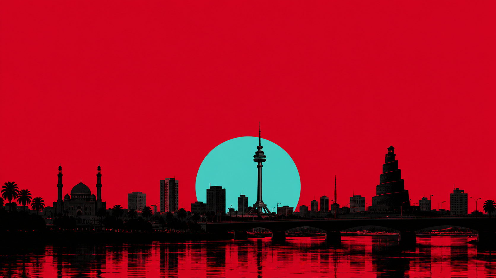
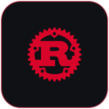
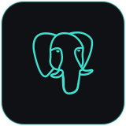
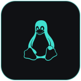
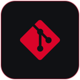
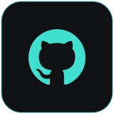

<div align="center">
  
</div>

<div align="center">


<br/>

### INDEPENDENT DEVELOPER

*Exploring technology. Understanding systems. Building ideas.*

<br/>

<a href="https://github.com/sam-iq2"></a>&nbsp;
&nbsp;


<br/><br/>

[ABOUT](#01--about) &nbsp;·&nbsp; [EXPLORATION](#02--areas-of-exploration) &nbsp;·&nbsp; [STACK](#03--technology-stack) &nbsp;·&nbsp; [DIRECTION](#04--current-direction) &nbsp;·&nbsp; [PRINCIPLES](#05--principles)

</div>


## 01 / ABOUT

I'm an **independent developer** interested in the architecture behind software, the logic of systems, and the intersection of technology and creativity.

I believe in **understanding the fundamentals** before building on top of them.

Currently learning, experimenting, and developing projects with a focus on **clarity, reliability, and thoughtful design**.


## 02 / AREAS OF EXPLORATION

| FIELD | INTEREST |
|:--|:--|
| **Systems Programming** | Rust, performance, memory safety |
| **Database Engineering** | SQL, PostgreSQL, data architecture |
| **Software Development** | Application architecture, backend systems |
| **Open Source** | Linux, Git, collaborative development |
| **Creative Technology** | Digital art, design, AI-assisted workflows |


## 03 / TECHNOLOGY STACK

<div align="center">

<br/>

&nbsp;&nbsp;&nbsp;

&emsp;&emsp;&emsp;
&nbsp;&nbsp;&nbsp;
&nbsp;&nbsp;&nbsp;


<br/><br/>

</div>


## 04 / CURRENT DIRECTION

```text
 01  LEARN    ──►  Understand the fundamentals
 02  DESIGN   ──►  Think about the architecture
 03  BUILD    ──►  Turn concepts into working software
 04  REFINE   ──►  Improve, simplify, and optimize

              ↺   repeat
```


## 05 / PRINCIPLES

<div align="center">

<br/>

<h3>
THINK DEEPLY.<br/>
BUILD INTENTIONALLY.<br/>
NEVER STOP EXPLORING.
</h3>

<br/>


<br/>

<sub>INDEPENDENTLY LEARNING &nbsp;·&nbsp; CONSTANTLY EVOLVING</sub>

<br/><br/>

**SARMAD** &nbsp;/&nbsp; `sam-iq2`

</div>
